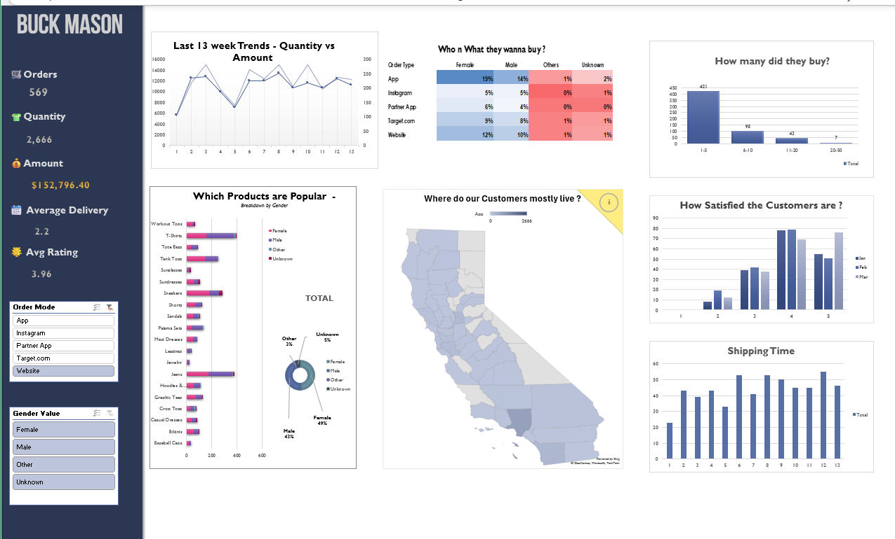

# Sales-Performance-Dashboard-Excel --

An interactive Microsoft Excel dashboard analyzing 13 weeks of retail apparel sales across California (Jan–Mar 2025), tracking revenue, order volume, customer demographics, delivery speed, and product satisfaction.

## Dashboard Preview  --

## Key Metrics (Q1 2025 / Weeks 1–13)
- **Total Orders:** 2,400
- **Total Quantity Sold:** 11,997 units
- **Total Revenue:** $649,019.80
- **Average Customer Rating:** 3.96 / 5.0
- **Average Delivery Time:** 2.34 days

## Business Questions Answered --
- **13-Week Sales Trend:** Weekly order volume and revenue progression across Weeks 1–13.
- **Channel Performance:** Order split across **App** (868), **Website** (569), **Target.com** (453), **Partner App** (262), and **Instagram** (248).
- **Top Products:** Best-selling items led by **T-Shirts** (325 orders), **Jeans** (286), **Sneakers** (247), and **Tank Tops** (187).
- **Customer Demographics:** Gender distribution across Female (51.3%), Male (40.0%), Unknown (5.6%), and Other (3.1%).
- **Geographic Breakdown:** County-level concentration across California, led by **Los Angeles County** (781 orders), **San Diego County** (330), and **Sacramento County** (162).
- **Operations & Satisfaction:** Delivery turnaround times (`Days to Deliver`) and customer ratings (`Rating C`).

## Tech Stack & Excel Features --
- **Microsoft Excel**
- **Pivot Tables & Pivot Charts** for multi-dimensional aggregation
- **Interactive Slicers** for dynamic filtering across channels, products, and demographics
- **Data Cleaning & Feature Engineering** (`Days to Deliver`, `Weeknum`, `Gender Value` mapping).
